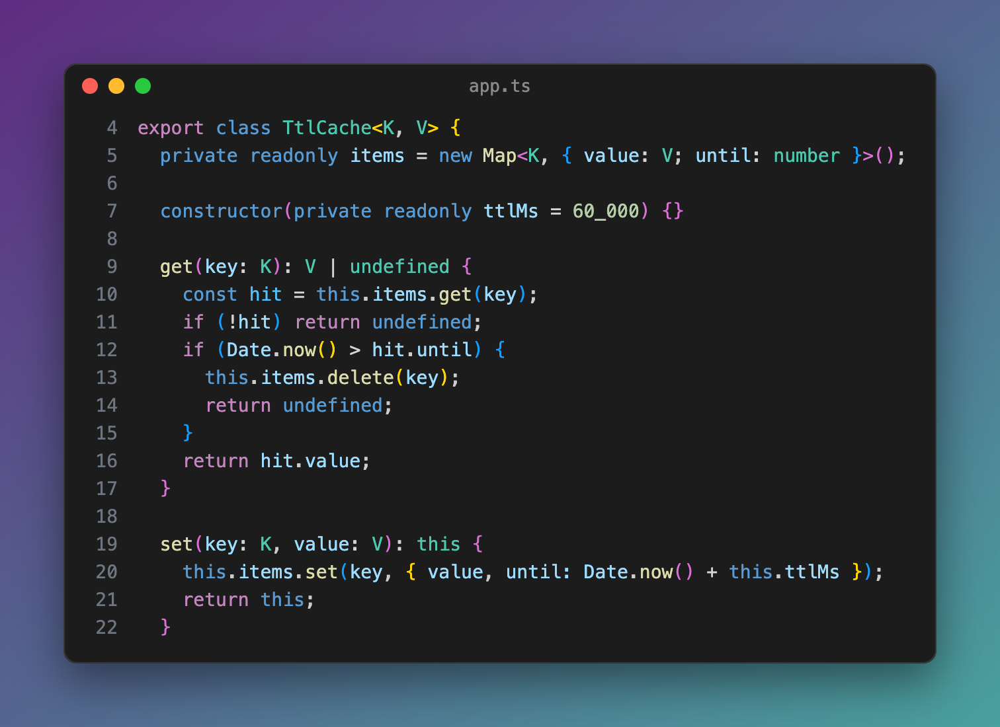
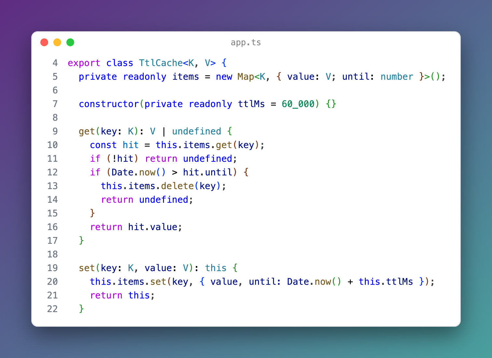

# Code Screenshot & Code Snapshot (Copy Code as Image, PNG/SVG)

Select code, press Cmd+Alt+C (Shift+Alt+C on Windows and Linux), and a PNG of it is on your clipboard. It is drawn with your editor theme, font, size, ligatures and bracket colors. Free, no sign-in, works offline.

*Real output from VS Code 1.142 on macOS: the packaged extension in a clean profile, the shortcut pressed through the debug port by `scripts/e2e-vscode.mjs`. The picture below is the PNG it put on the clipboard.*

- One key, then paste: no button to press in a panel, no website, no link. The panel beside the editor shows what was copied and keeps your editor focused.
- You get the image, not the text. The PNG goes on the clipboard with local system commands. If that fails, the panel says why, leaves your clipboard as it was and offers Save PNG. It never pastes an old clipboard item as the "screenshot".
- It looks like your editor. The colors come from the TextMate engine VS Code uses, with your color theme, your token color customizations and bracket pair colors. The font is your `editor.fontFamily`, size, weight, line height and ligatures, and the panel waits for fonts before it draws.

## Quick start

1. Select the lines you want. Partial lines are fine: whole lines are taken, so the indent is right.
2. Press Cmd+Alt+C (Shift+Alt+C), or right-click and pick Copy as Image (PNG).
3. Paste into a chat, an issue, a doc or a slide.

"Code Screenshot: Get Started" in the Command Palette opens a short tour.

## What you can change

| Option | What it does |
|---|---|
| Copy PNG, Save PNG, Save SVG, Copy SVG | PNG at 1x, 2x, 3x or 4x. SVG keeps the code as text, so it is sharp at any size and the text can be selected. |
| Line numbers | The real line numbers from the file, so line 40 says 40. |
| Highlight lines | Click a line in the picture to highlight it, Shift+click for a range. |
| Mark a word | Double-click a word in the picture, or type it in Mark text to mark every match. |
| Frame | A window with three dots, a plain window, or no window. The title is the file name or your own text. |
| Background | Five gradients, one color, the editor color, or transparent (PNG and SVG keep the transparency). Padding, shadow and rounded corners. |
| Remove common indent | A nested block starts at the left edge. The indent inside it stays. Tabs become spaces at your tab size. |
| Wrap at N columns | Long lines wrap and keep their indent. Off by default, so nothing is stretched or squeezed. |
| Folded code and gaps | A folded region is one "folded lines" row. With several selections, the lines between them are one "⋯" row. |

Your choices are kept for the next picture. Settings (`codeScreenshot.*`) give the defaults.

## Saving files

Save PNG and Save SVG name the file after the lines, for example `app.ts-L12-L40.png`, and open the folder you saved to last. Set `codeScreenshot.saveFolder` (you can use `~` and `${workspaceFolder}`) to always use one folder. Turn off `codeScreenshot.askWhereToSave` to save at once without the dialog.

## Themes

The picture follows the theme you use, including high contrast themes and themes from the Marketplace. Change the theme and the open panel draws again.

## Large selections and minified files

Code Screenshot reads only the lines you selected, plus up to 3,000 lines before them so a comment or string that starts earlier is colored right. It never loads the whole file into the extension.

- A selection longer than `codeScreenshot.maxLines` (1,000) draws its first 1,000 lines and says how many were left out.
- Lines longer than `codeScreenshot.maxLineLength` (1,000 characters) are cut with a "…" and a note. In our tests a 10 MB one-line minified file was copied in 0.5 to 4.4 seconds (the slow run was on a very busy machine), and the editor stayed responsive.
- A PNG that would be wider or taller than 16,384 pixels at the scale you picked is made at a smaller scale, and the panel tells you the scale it used. SVG has no such limit.

## Remote windows, WSL and the browser

In Remote SSH, WSL and Dev Containers windows the extension runs on your own computer (it asks for the UI side first), so the clipboard is yours. In a browser (for example code-server), the panel copies the image itself; if the browser does not allow it, it offers Save PNG.

| System | Clipboard command |
|---|---|
| macOS | `osascript` (built in) |
| Windows | PowerShell (built in) |
| Linux | `xclip` on X11, `wl-copy` (wl-clipboard) on Wayland |

## Privacy

No account, no telemetry, no network. The panel's content security policy blocks every remote source, code is drawn with DOM text nodes (so `<script>` in your code is just text), and the extension makes no network calls. The rating question and the Sponsor links sit in the panel, never in the picture, and can be turned off.

## Settings

| Setting | Default | |
|---|---|---|
| `codeScreenshot.scale` | 2 | PNG scale 1 to 4 |
| `codeScreenshot.lineNumbers` | true | Line numbers |
| `codeScreenshot.frame` | mac | `mac`, `plain` or `none` |
| `codeScreenshot.showTitle` | true | File name in the frame |
| `codeScreenshot.background` | gradient-1 | Gradients, `solid`, `editor`, `transparent` |
| `codeScreenshot.backgroundColor` | #6c5ce7 | Color for `solid` |
| `codeScreenshot.padding` | 48 | Space around the window |
| `codeScreenshot.shadow` | true | Window shadow |
| `codeScreenshot.cornerRadius` | 10 | Rounded corners |
| `codeScreenshot.removeCommonIndent` | true | Move a nested block to the left edge |
| `codeScreenshot.wrapColumn` | 0 | Wrap at N columns (0 is off) |
| `codeScreenshot.fontFamily` | (editor font) | Another font for pictures only |
| `codeScreenshot.maxLines` | 1000 | Line limit |
| `codeScreenshot.maxLineLength` | 1000 | Characters per line |
| `codeScreenshot.whenNothingSelected` | visible | `visible` lines or the whole `file` |
| `codeScreenshot.saveFolder` | (last folder) | Folder for saved files |
| `codeScreenshot.askWhereToSave` | true | Show the save dialog |
| `codeScreenshot.followSelection` | true | Update the open panel when you select other lines |

## Limits

- Colors come from TextMate grammars, like the editor without semantic highlighting. With themes that use semantic colors (for example some TypeScript variables), a few tokens can differ from the editor.
- A folded region is found from the editor's visible lines, so a fold that is scrolled out of view counts as unfolded.
- The SVG names your font; a computer without that font shows the next one in the list. The PNG has the font drawn in.

## Support Zovo

Zovo extensions are free, with no ads and no tracking. They are made by [theluckystrike](https://github.com/theluckystrike) on GitHub. If this one saves you time, you can support the work:

- [Sponsor on GitHub](https://github.com/sponsors/theluckystrike)
- [Follow theluckystrike on GitHub](https://github.com/theluckystrike)

## More tools by Zovo

- [Graphviz Viewer & DOT Viewer (Live Preview)](https://marketplace.visualstudio.com/items?itemName=zovo.zovo-graphviz-preview) shows a live preview of DOT files and exports SVG or PNG.
- [HAR Viewer & HAR File Analyzer (HTTP Archive, Network Log)](https://marketplace.visualstudio.com/items?itemName=zovo.zovo-har-viewer) opens HAR files from browser DevTools with a timing waterfall, filters and a redacted copy for sharing.
- [Large JSON Viewer, JSON Browser & JSON Tree](https://marketplace.visualstudio.com/items?itemName=zovo.zovo-json-tree-viewer) shows large JSON files as a searchable tree, copies JSONPath and turns arrays of objects into a table.
- [PDF Viewer & PDF Reader](https://marketplace.visualstudio.com/items?itemName=zovo.pdf-viewer-dark) reads PDFs with a real dark mode, search, an outline and thumbnails.
- [DOCX Viewer, Word Viewer & DOCX Preview (Dark Mode)](https://marketplace.visualstudio.com/items?itemName=zovo.docx-viewer-vscode) previews Word and ODT files with dark mode, an outline and search.

See [all Zovo extensions on the Marketplace](https://marketplace.visualstudio.com/publishers/zovo).

## License

MIT
